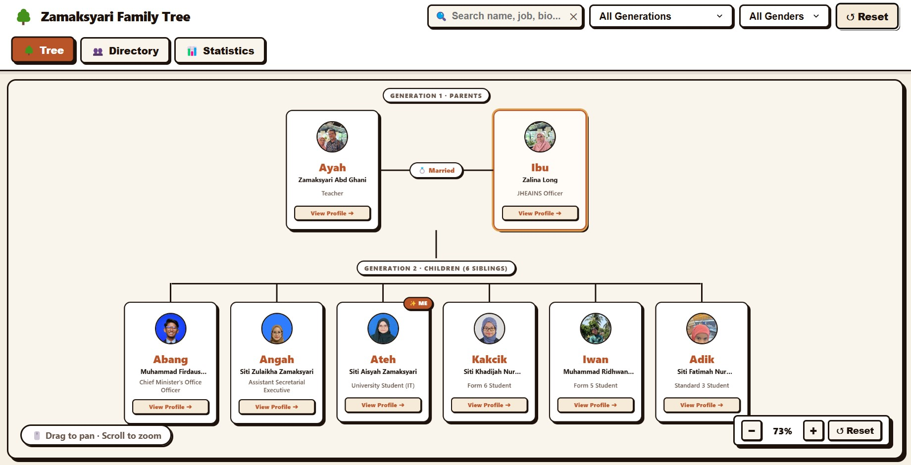
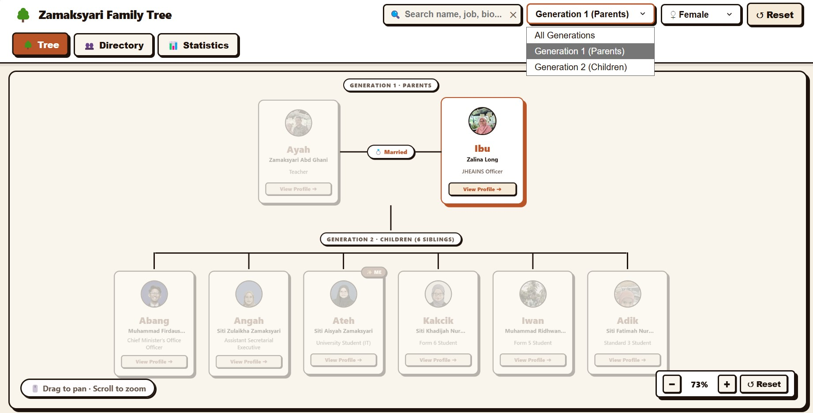
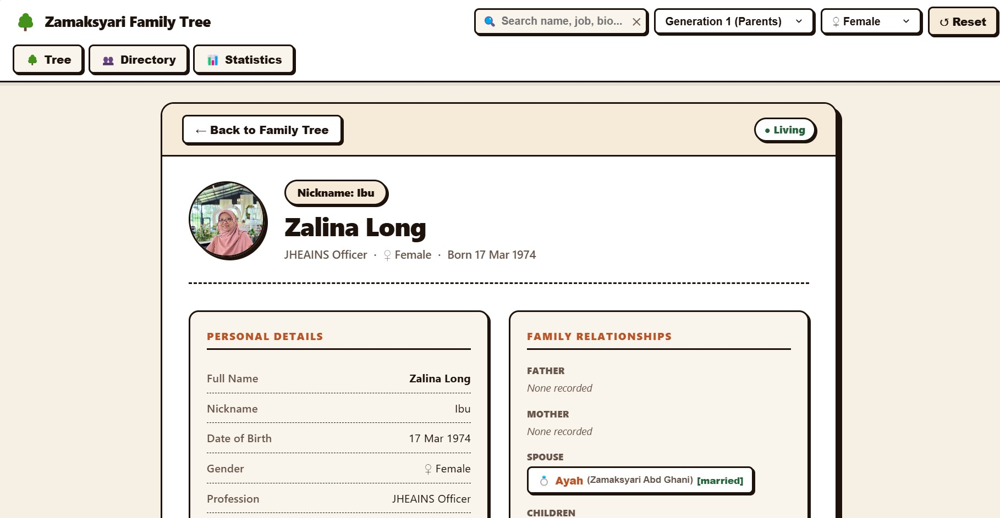
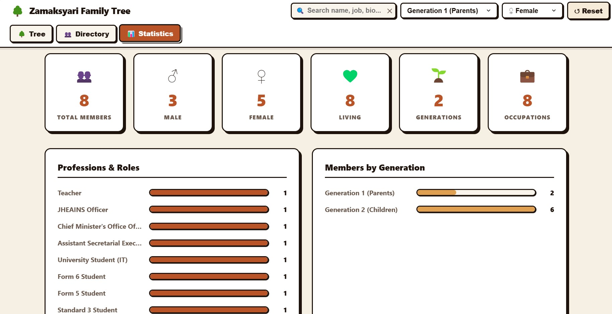

# 🌳 Zamaksyari Family Heritage Tree
### ITT588 — Web Application Development (Lab Work 4)

> **Student Name:** Siti Aisyah binti Zamaksyari  
> **Course:** ITT588 — Web Application Development  
> **Lab Assessment:** Lab Work 4 — Interactive Family Heritage Tree Application  
> **Architecture Pattern:** Pure Model-View-Controller (MVC)  
> **Design Theme:** Earthy Minimal Neobrutalism  

---

## 📑 Table of Contents
1. [Project Overview](#-project-overview)
2. [Lab Objectives & Fulfillment](#-lab-objectives--fulfillment)
3. [System Architecture (MVC Pattern)](#-system-architecture-mvc-pattern)
4. [Dataset & JSON Schema](#-dataset--json-schema)
5. [Family Members Directory](#-family-members-directory)
6. [Key Features & User Interface](#-key-features--user-interface)
   - [Interactive Pan & Zoom Tree Canvas](#1-interactive-pan--zoom-tree-canvas)
   - [Comprehensive Navigation System](#2-comprehensive-navigation-system)
   - [Top Bar Multi-Attribute Data Filtering](#3-top-bar-multi-attribute-data-filtering)
   - [Detailed Member Profile & Kinship Ties](#4-detailed-member-profile--kinship-ties)
   - [Demographic Analytics & Statistics](#5-demographic-analytics--statistics)
7. [Design System: Earthy Minimal Neobrutalism](#-design-system-earthy-minimal-neobrutalism)
8. [Application Screenshots](#-application-screenshots)
9. [Conclusion](#-conclusion)

---

## 🌟 Project Overview

The **Zamaksyari Family Heritage Tree** is a responsive, interactive front-end web application developed for **ITT588 Lab Work 4**. The application visualises the heritage, lineage, and genealogical relationships of the Zamaksyari family (comprising two generations: parents and six siblings).

Built using **Vanilla JavaScript, HTML5, and CSS3**, the project strictly adheres to the **Model–View–Controller (MVC)** architectural design pattern, ensuring complete separation of concerns between data management, DOM rendering, and user interaction handling. The dataset is modeled dynamically from an external JSON file following the open-source [geoseiden/Family-Tree](https://github.com/geoseiden/Family-Tree/blob/main/public/data/people.json) schema specification.

---

## 🎯 Lab Objectives & Fulfillment

| Lab Objective | Implementation in Application | Source Code Reference |
|---|---|---|
| **1. Retrieve and process family heritage data from a JSON dataset using JavaScript** | The application dynamically fetches `./data/people.json` using the native JavaScript `fetch()` API asynchronously. Raw records are parsed, normalised, and converted into an internal graph model. | `public/js/model/FamilyModel.js` (`load()` & `_normalise()`) |
| **2. Apply JavaScript to display member information and relationships dynamically** | All DOM elements, tree hierarchy nodes, member cards, kinship connection tags, and statistics are dynamically generated at runtime. No family data is hardcoded into HTML. | `public/js/view/FamilyView.js` (`renderTree()`, `renderProfile()`, etc.) |
| **3. Visualise family relationships (parents, spouses, and children)** | Renders Generation 1 (Father & Mother joined by a `💍 Married` marriage bridge) and Generation 2 (6 siblings aligned in a neat horizontal line connected by branching tree lines). | `public/js/view/FamilyView.js` & `public/css/style.css` |
| **4. Implement data filtering and navigation features** | Integrated real-time keyword search, Generation dropdown filters, Gender dropdown filters, 3 main view tabs, clickable kinship buttons inside profiles, back navigation, and canvas pan/zoom. | `public/js/controller/FamilyController.js` |

---

## 🏛️ System Architecture (MVC Pattern)

This project strictly follows the **Model-View-Controller (MVC)** pattern to ensure clean modularity and maintainability:

```
                      ┌─────────────────────────────────┐
                      │    public/data/people.json      │
                      └────────────────┬────────────────┘
                                       │ fetch()
                                       ▼
  ┌────────────────────────────────────────────────────────────────────────┐
  │                           MODEL (FamilyModel.js)                       │
  │  • Loads & normalises JSON dataset                                     │
  │  • Computes relationships (father, mother, spouses, children, siblings)│
  │  • Calculates generation levels via Breadth-First Search (BFS)         │
  │  • Executes multi-attribute search & filtering algorithms              │
  │  • Derives demographic & occupation statistics                         │
  └────────────────────────┬───────────────────────────▲───────────────────┘
                           │ Data Output               │ Query / Filter
                           ▼                           │
  ┌────────────────────────────────────────────────────┴───────────────────┐
  │                       CONTROLLER (FamilyController.js)                 │
  │  • Bootstraps application on DOMContentLoaded                          │
  │  • Listens to user events (search, dropdown changes, nav tabs)         │
  │  • Implements canvas pan & zoom mouse/wheel interactions               │
  │  • Orchestrates state flow between Model and View                      │
  └────────────────────────┬───────────────────────────────────────────────┘
                           │ Renders State
                           ▼
  ┌────────────────────────────────────────────────────────────────────────┐
  │                            VIEW (FamilyView.js)                        │
  │  • Pure presentation layer (Zero business logic)                       │
  │  • Renders Tree canvas with single horizontal row of siblings          │
  │  • Renders Members Directory grid with active filter feedback          │
  │  • Renders Full Profile with clickable kinship buttons                 │
  │  • Renders Demographic bar charts & metrics                            │
  │  • Controls canvas pan & zoom CSS transforms                           │
  └────────────────────────────────────────────────────────────────────────┘
```

### Component Breakdown:
1. **Model (`public/js/model/FamilyModel.js`):**
   * Encapsulates raw data and all domain logic.
   * Dynamically resolves kinship ties: `getFather()`, `getMother()`, `getChildren()`, `getSiblings()`, `getSpouses()`.
   * Computes generational hierarchy dynamically by traversing ancestor links.
2. **View (`public/js/view/FamilyView.js`):**
   * Pure presentation layer that renders DOM elements.
   * Contains methods for rendering the Tree view, Directory grid, Profile details, and Statistics charts.
   * Manages smooth canvas transforms (`translate(x, y) scale(z)`).
3. **Controller (`public/js/controller/FamilyController.js`):**
   * Listens to DOM events: search inputs, dropdown filters, navigation tab clicks, card selections, and zoom/pan actions.
   * Queries the Model and instructs the View to update accordingly.

---

## 📊 Dataset & JSON Schema

The family data is stored in `public/data/people.json` conforming to the open-source **geoseiden Family-Tree schema**.

```json
[
  {
    "id": "p1",
    "nickname": "Ayah",
    "firstName": "Zamaksyari",
    "lastName": "Abd Ghani",
    "gender": "male",
    "dob": "1974-01-02",
    "dateOfDeath": "",
    "profession": "Teacher",
    "photo": "images/ayah.jpg",
    "fatherId": null,
    "motherId": null,
    "spouses": [
      { "id": "p2", "status": "married" }
    ],
    "bio": "Patriarch of the Zamaksyari family. Dedicated educator and loving father of six children."
  },
  {
    "id": "p2",
    "nickname": "Ibu",
    "firstName": "Zalina",
    "lastName": "Long",
    "gender": "female",
    "dob": "1974-03-17",
    "dateOfDeath": "",
    "profession": "JHEAINS Officer",
    "photo": "images/ibu.jpg",
    "fatherId": null,
    "motherId": null,
    "spouses": [
      { "id": "p1", "status": "married" }
    ],
    "bio": "Matriarch of the family and JHEAINS officer. The heart of the family, raising and nurturing six wonderful children."
  }
]
```

---

## 👨‍👩‍👧‍👦 Family Members Directory

The Zamaksyari family records in the application:

| ID | Malay Nickname | Full Real Name | Role / Profession | Date of Birth | Gender | Photo Asset |
|---|---|---|---|---|---|---|
| **p1** | Ayah | Zamaksyari bin Abd Ghani | Teacher | 02 Jan 1974 | Male | `images/ayah.jpg` |
| **p2** | Ibu | Zalina binti Long | JHEAINS Officer | 17 Mar 1974 | Female | `images/ibu.jpg` |
| **p3** | Abang | Muhammad Firdaus bin Zamaksyari | Chief Minister's Office Officer | 13 Jul 2001 | Male | `images/abang.jpg` |
| **p4** | Angah | Siti Zulaikha binti Zamaksyari | Assistant Secretarial Executive | 12 Dec 2002 | Female | `images/kakak.jpg` |
| **p5** | **Ateh (Me)** | **Siti Aisyah binti Zamaksyari** | **University Student (IT)** | **14 Mar 2005** | **Female** | `images/saya.jpg` |
| **p6** | Kakcik | Siti Khadijah Nur binti Zamaksyari | Form 6 Student | 19 Jun 2007 | Female | `images/adik_perempuan.jpg` |
| **p7** | Iwan | Muhammad Ridhwan bin Zamaksyari | Form 5 Student | 11 Jun 2009 | Male | `images/adik_lelaki.jpg` |
| **p8** | Adik | Siti Fatimah Nur binti Zamaksyari | Standard 3 Student | 28 Dec 2017 | Female | `images/bongsu.jpg` |

---

## 🚀 Key Features & User Interface

### 1. Interactive Pan & Zoom Tree Canvas
* **Single Horizontal Row Alignment:** Unlike cluttered layouts, all six siblings in Generation 2 are aligned in **one single straight horizontal line**, linked by an overhead horizontal branch line and vertical drop connectors.
* **Drag-to-Pan (Move):** Users can click and drag anywhere on the canvas to pan smoothly around the family tree (`cursor: grab / grabbing`).
* **Scroll-to-Zoom:** Users can zoom in and out using their mouse wheel with zero lag.
* **Discrete Floating Controls:** A small, neat neobrutalist zoom widget (`[-] 100% [+] [↺ Reset]`) sits at the bottom right corner without obstructing the view.
* **No Vertical Page Scrolling:** The tree viewport utilizes full viewport height for an immersive experience.

### 2. Comprehensive Navigation System
The application implements four distinct navigation layers:
1. **Top Bar View Navigation:** Instant tab switching between `[🌳 Tree]`, `[👥 Directory]`, and `[📊 Statistics]`.
2. **Interactive Kinship Navigation:** In any profile view, every listed relative (Father, Mother, Spouse, Children, Siblings) is a clickable navigation button. Clicking on `👨 Ayah` immediately navigates to Ayah's profile; clicking on `🧒 Adik` transitions directly to Adik's profile.
3. **Contextual Back Navigation:** A `← Back to Family Tree` button seamlessly returns users to the exact view they came from.
4. **Spatial Canvas Navigation:** Drag-to-pan and scroll-wheel zoom provide spatial navigation across the genealogical diagram.

### 3. Top Bar Multi-Attribute Data Filtering
Filters are organized in the top bar using compact dropdown selects and search:
* **Keyword Search:** Real-time search by full name, nickname, profession, or biography.
* **Generation Dropdown:** Quick filter by `All Generations`, `Generation 1 (Parents)`, or `Generation 2 (Children)`.
* **Gender Dropdown:** Filter by `All Genders`, `♂ Male`, or `♀ Female`.
* **Visual Highlighting on Canvas:** Non-matching cards are dimmed (`opacity: 0.30; grayscale(70%)`), while matching cards remain highlighted.

### 4. Detailed Member Profile & Kinship Ties
* **Collision-Free Header:** Displays the member's photo avatar, Malay nickname pill, full name, profession, and living status without awkward overlap.
* **Personal Details Grid:** Neobrutalist card summarizing official full name, nickname, date of birth, gender, profession, and status.
* **Kinship Relations Grid:** Lists dynamic family connections (parents, spouse, children, siblings) as clickable pill buttons.
* **Personal Biography Callout:** Showcases personal achievements, studies, and notes.

### 5. Demographic Analytics & Statistics
* **Summary Metric Cards:** Total members, male count, female count, living members, generations count, and occupations count.
* **Occupation Breakdown Chart:** Dynamic horizontal progress bars illustrating job distribution.
* **Generational Distribution Chart:** Visual representation of family population across generations.

---

## 🎨 Design System: Earthy Minimal Neobrutalism

The interface combines the warmth of family heritage with the bold clarity of **Neobrutalism**:

* **Earthy Color Palette:**
  * Background: Warm natural linen / oatmeal (`#f5efe4`)
  * Surface Cards: Clean white (`#ffffff`) and soft parchment (`#faf5ec`)
  * Primary Accent: Earthy terracotta / burnt clay (`#b85428`)
  * Secondary Accent: Warm ochre / honey (`#dfa052`)
  * Borders & Shadows: Bold dark espresso (`#1e130c`)
* **Neobrutalist Styling Principles:**
  * Crisp, solid 2.5px dark espresso borders (`border: 2.5px solid #1e130c`).
  * Hard offset drop shadows (`box-shadow: 4px 4px 0px #1e130c`) with zero blur.
  * Tactile interactive feedback: buttons lift on hover (`translate(-2px, -2px)`) and press down when clicked (`translate(1px, 1px)`).
  * High-contrast bold typography with clear visual hierarchy.

---

## 📸 Application Screenshots

### 🌳 1. Interactive Family Tree View (Pan & Zoom Canvas)

*Single horizontal row of 6 siblings with overhead branching line, parent marriage bridge, and bottom-right zoom widget.*

---

### 👥 2. Family Members Directory & Filter

*Responsive grid of family member cards filtered dynamically via top bar search and dropdowns.*

---

### 👤 3. Member Profile View (Kinship Connections)

*Clean, well-spaced profile showcasing personal details, bio quote, and clickable kinship buttons for relational navigation.*

---

### 📊 4. Family Statistics & Analytics View

*Demographic metrics and animated distribution charts calculated dynamically from the JSON dataset.*

---

## 📝 Conclusion

The development of the **Zamaksyari Family Heritage Tree Application** successfully achieves all learning outcomes and technical requirements stipulated for **ITT588 Lab Work 4**:

1. **Practical Mastery of the MVC Pattern:**  
   By strictly separating the project into **Model (`FamilyModel.js`)**, **View (`FamilyView.js`)**, and **Controller (`FamilyController.js`)**, the codebase achieves high modularity, readability, and scalability. Business logic, such as kinship calculations and generation grouping, remains fully decoupled from DOM manipulation.

2. **Dynamic Asynchronous Data Processing:**  
   Retrieving and normalizing external records from `people.json` via the native JavaScript `fetch()` API demonstrated the power of dynamic, data-driven web applications over static, hardcoded pages.

3. **Advanced Frontend UI/UX Design:**  
   The application demonstrates modern frontend engineering through an **Earthy Minimal Neobrutalism** design language. Replacing traditional static tables with an **interactive pan-and-zoom tree canvas**, a single aligned row of Generation 2 siblings, top bar dropdown filtering, and interconnected kinship navigation provides an engaging user experience.

In summary, this project not only serves as a meaningful digital archive preserving the heritage and lineage of the Zamaksyari family, but also reflects comprehensive competence in modern Vanilla JavaScript, CSS architecture, and client-side software engineering.

---

*Submitted for ITT588 Web Application Development — Lab Work 4*  
*Faculty of Computer & Mathematical Sciences / College of Computing*  
*© 2026 Siti Aisyah binti Zamaksyari. All rights reserved.*
